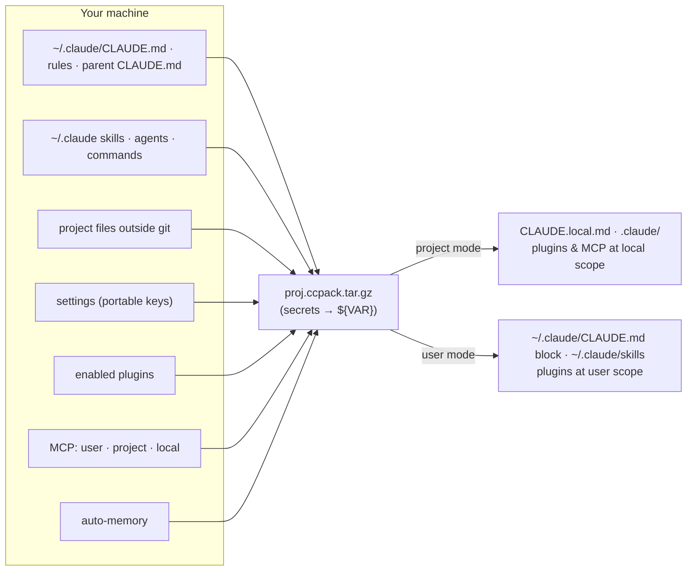

<div align="center">

```
╭──┬──╮
│ ◕ ◕ │   ccpack
│  ▿  │   git clone carries the code. ccpack carries the Claude.
╰─────╯
```

**Hand a teammate your Claude Code setup for one project. Secrets stay home. One command undoes it.**

<!-- demo: `vhs demo.tape` renders demo.gif -->

</div>

Sync tools mirror *your* config across *your* machines. ccpack hands *one project's* setup to *someone else*: your instructions, memory, skills, plugins and MCP servers, with credentials stripped and every change reversible.

```bash
npx ccpack pack                          # in your project → ../<project>.ccpack.tar.gz
npx ccpack install proj.ccpack.tar.gz    # in their clone: review, install, enter their own keys
npx ccpack uninstall                     # back to exactly how it was
```

Run `npx ccpack` with no arguments for the interactive menu.

## Why

Claude Code's behaviour on a project comes from layers spread across your machine: `~/.claude/CLAUDE.md`, parent-directory instructions, auto-memory under `~/.claude/projects/<slug>/`, user skills (often symlinks), plugins and their marketplaces, MCP servers in three scopes, settings in four files. `git clone` carries only the tracked part, and there is no official export ([anthropics/claude-code#22648](https://github.com/anthropics/claude-code/issues/22648)).

| | Config sync tools | Multi-agent projectors | **ccpack** |
|---|---|---|---|
| For | yourself, across your machines | yourself, across agents | **a teammate** |
| Scope | your whole `~/.claude` | your declared config | **one project, every layer** |
| Secrets | encrypted copies of yours | references | **stripped; they enter their own** |
| Undo | — | — | **journaled, exact** |

## Safety

- **Secrets stay home.** Credential-looking values in MCP env, headers, args and URLs become `${VAR}` placeholders, and env vars or rules carrying a credential are dropped. Detection works by known formats and opaque-token shapes, so it can miss a secret in an unusual form. A final scan refuses to write a package that still matches. Run `ccpack inspect` on your package before you send it.
- **Anything that runs code is opt-in, twice.** Hooks and hook scripts, plugins from local marketplaces, env vars beyond Claude Code's own switches (`PATH`, `BASH_ENV`, proxies…), and `statusLine` / `apiKeyHelper` commands are left out by default. The sender ticks what to include (`--include`). The receiver sees every command and ticks what to accept (`--accept`). `bypassPermissions` never travels.
- **The receiver reviews first.** `ccpack inspect` and the install screen list every MCP server (command, URL, env, header names), plugin source, permission rule, env var and project file before anything is written. Packages are validated: no links, no `..`, only known paths, strict MCP shapes, settings filtered again on arrival. Writes never follow a link out of the project or the Claude config. MCP servers are registered once you confirm that list, and Claude Code won't prompt for them again. Plugins from git marketplaces can bring their own hooks, as they would with `claude plugin install`.
- **The receiver's choices win.** Existing settings, skills and MCP servers are kept. A same-name server is never merged into. Conflicts are reported, not overwritten.
- **Undo reverts what ccpack changed, nothing else.** Every file, JSON key and line is journaled, by hash. `uninstall` restores original files and keeps anything changed since: a memory Claude updated, a rule you added. Keys typed in `connect` live only in `~/.claude.json`, and the journal is private (`0600`).
- **No network, no telemetry from ccpack.** Only `claude plugin` calls reach plugin marketplaces.

What *is* shared on purpose: your instructions, user skills and auto-memory for the project. `inspect` your own package before sending it. Details in [SECURITY.md](SECURITY.md).

## What travels

| Layer | Packed | Notes |
|---|---|---|
| `~/.claude/CLAUDE.md`, `~/.claude/rules/`, parent `CLAUDE.md` | ✓ | merged in load order |
| Project files outside git | ✓ | `.claude/{skills,agents,commands,output-styles,rules}`, `CLAUDE.md` files, `AGENTS.md` — modified, untracked or gitignored; hook scripts are opt-in |
| User skills, agents, commands, output styles | ✓ | symlinks dereferenced; same-name project items win |
| Settings | portable keys | `language`, `permissions`, `autoMode`, `effortLevel`, `model`, Claude Code `env` switches… |
| Plugins | enabled ones | GitHub/git marketplaces by reference |
| Hooks, local-marketplace plugins, other env vars, statusLine/apiKeyHelper | opt-in | `--include` to pack, `--accept` to install |
| MCP servers (project, user, local scope) | templated | scope precedence resolved as Claude Code does |
| Auto-memory | `memory/` only | transcripts stay home |
| Keys, OAuth tokens | ✗ | entered by the teammate in `connect` |
| claude.ai connectors, account-synced skills | ✗ | bound to the claude.ai account — listed for the teammate |

<details>
<summary>Diagram</summary>



</details>

## Install modes

| | `--mode project` (default) | `--mode user` |
|---|---|---|
| Instructions | `CLAUDE.local.md` | marked block in `~/.claude/CLAUDE.md` |
| Skills, agents… | the project's `.claude/` | `~/.claude/` |
| Settings | `.claude/settings.local.json` | `~/.claude/settings.json` + project local |
| Plugins | local scope | user scope |
| MCP servers | `~/.claude.json`, local scope | user-scope ones at user scope |
| Effect | this project only | all the teammate's projects |

Memory lands under the clone's own path, and its index is merged. New files are kept out of `git status` via `info/exclude`. A tracked file the package updates (an uncommitted edit of yours) shows as modified, and the review flags it.

## Connect

Keys and logins can't travel. `ccpack connect` shows each MCP server's health and asks for the missing variables with masked input. It writes the filled servers straight into `~/.claude.json`, never on a command line and never in the project. Re-run it to change a key. It also lists the claude.ai connectors to enable with the teammate's own account. For scripts, pass `CCPACK_SECRETS='{"VAR":"…"}'`.

## Commands

```
ccpack                                    interactive menu
ccpack pack [project] [-o dir] [--exclude-skill name]… [--include hooks,marketplaces,env,commands|all]
ccpack inspect <pkg.tar.gz> [project] [--mode project|user]
ccpack install <pkg.tar.gz> [project] [--mode project|user] [--accept hooks,marketplaces,env,commands|all]
ccpack connect [project] [--check]
ccpack verify [project] [--live]          --live: one claude -p call checks skills, plugins, MCP, memory, instructions
ccpack uninstall [project]

--json   one JSON event per line          --yes   no prompts
```

## Limits

- Claude Code's memory slug rule (every non-alphanumeric character → `-`) is undocumented, and very long paths are not handled.
- `permissions.additionalDirectories` and absolute paths inside your memory are reported, not rewritten.
- Close running Claude Code sessions before install, connect or uninstall: they rewrite `~/.claude.json` too.
- macOS and Linux. Windows is not supported yet.
- Requires Node ≥ 20, `git`, `tar` and the `claude` CLI.

## Roadmap

- Pick skills at pack time.
- `ccpack graph`: which project uses which skills, plugins and MCP servers, from the same inventory `pack` builds.
- Session mining: which skills a project actually uses, from `~/.claude/projects/*/*.jsonl`, joined on inventory ids.
- Other agents (Codex, Gemini CLI…) once the format has settled.

## TODO

Known gaps, deliberately left for later. Contributions welcome.

- **Secret detection is heuristic.** Known formats, plus opaque tokens in JSON configs. A password written in prose in a memory file, or a token in an unusual shape, can pass. Always `inspect` before sending.
- **Concurrent writes.** `~/.claude.json` is read-modified-written without a lock, and a running Claude Code session can race with install, connect or uninstall.
- **Hooks review.** `inspect` lists `command` hooks. Other hook types (prompt, agent, http) and hooks shipped inside git-marketplace plugins are not itemised.
- **Secrets to the UI's child process.** They pass through an environment variable (`CCPACK_SECRETS`). stdin would be tighter.
- **Paths.** `permissions.additionalDirectories` and absolute paths inside memory files are reported, not rewritten. Project paths longer than ~200 characters (Claude Code hash-truncates the memory slug) are not handled.
- **Windows.** Not supported: `claude.cmd` resolution and path separators in git excludes.
- **Release hygiene.** No CI or npm provenance yet. The `demo.gif` is not recorded (`vhs demo.tape`).

## Contributing

```bash
npm install && npm test                            # black-box CLI tests on a synthetic setup, stub claude CLI
test/e2e-docker.sh <pkg.tar.gz> <project repo>     # real claude CLI in a fresh container, both modes
```

The package format is a documented contract: [FORMAT.md](FORMAT.md). `src/core/inventory.ts` collects, `pack.ts` writes, `format.ts` validates, `install.ts` applies, and `journal.ts` records and undoes.

## License

MIT. Unofficial: not affiliated with or endorsed by Anthropic.
